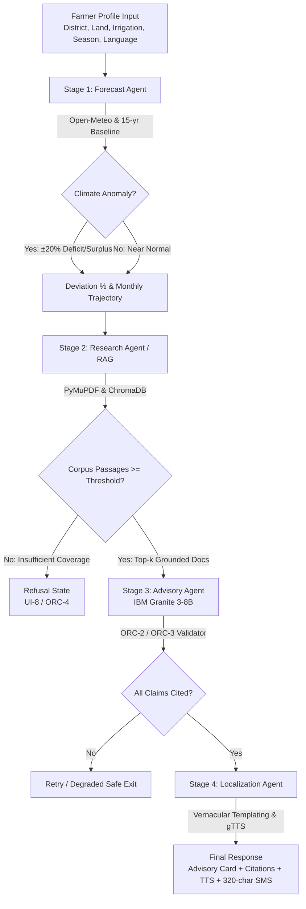

# Fallow 🌱
### Climate-Aware Crop Planning Advisory System
*Powered by IBM Granite 3-8B, ChromaDB Grounded RAG, and LangGraph Orchestration*

---

## 🌟 Executive Overview

**Fallow** is a production-quality, climate-aware crop planning agent pipeline designed for smallholder farmers and agricultural extension officers across India. 

Instead of relying on ungrounded generative LLM guesses, Fallow combines **Open-Meteo 15-year historical climate baselines**, **seasonal precipitation anomaly forecasting**, **deep local agronomic corpus RAG (ICAR, MPKV Rahuri, TNAU)**, and **IBM Granite 3-8B reasoning** with **100% strict provenance enforcement**.

### The Anti-Hallucination Spine
- **ORC-2**: Hard-blocks any crop recommendation claim lacking non-empty citation references.
- **ORC-3**: Validates every single `citation_id` resolves programmatically to an authenticated passage in the agronomic corpus.
- **ORC-4**: Explicitly invokes the **Refusal Path** (`sufficient_guidance=False`) if relevant corpus coverage is below threshold, rather than inventing guidance.
- **AD-6**: Constrains candidate crops strictly to locally available and marketable varieties.
- **LC-1 / LC-5**: Renders vernacular translations and TTS audio directly from structured data models, preventing linguistic drift.

---

## 🏗️ Architecture & Sequential Pipeline



### 1. Forecast Agent (FC-1 to FC-6)
- Resolves district coordinates (e.g., Aurangabad `19.8762°N, 75.3433°E`; Thanjavur `10.7870°N, 79.1378°E`).
- Analyzes seasonal rainfall against a 15-year historical mean.
- Flagged anomaly if deviation exceeds configurable `ANOMALY_THRESHOLD_PCT` (default: 20%).

### 2. Research Agent (RS-1 to RS-7)
- Builds targeted semantic queries incorporating agro-climatic zone, forecast deviation, and candidate crop sets.
- Retrieves from ChromaDB vectorstore with a strict relevance floor (`RELEVANCE_FLOOR=0.35`).
- Drops any chunk lacking a resolvable `source_uri`.

### 3. Advisory Agent (AD-1 to AD-7)
- Synthesizes ranked crop options using **IBM Granite 3-8B** with temperature `0.2`.
- Outputs strictly schema-validated JSON matching Pydantic contracts.
- Auto-hedges (`hedged=True`) when climate confidence is moderate/low.

### 4. Localization Agent (LC-1 to LC-6)
- Renders structured advisories into Marathi, Hindi, Tamil, and English.
- Formats dual-segment SMS payloads (≤ 320 characters).
- Synthesizes spoken audio via TTS.

---

## 🧪 Contrasting Demo Districts (T6 Verified)

| Dimension | Aurangabad (IN-MH-AUR) | Thanjavur (IN-TN-TNJ) |
|---|---|---|
| **Agro-Climatic Zone** | Scarcity Zone (Semi-Arid Tropics) | Cauvery Delta Zone (Humid Tropics) |
| **Monsoon Forecast** | **-35.0% Severe Rainfall Deficit** (468mm vs 720mm) | **Near-Normal** (385mm vs 410mm) |
| **Water Source** | Rainfed / Dryland | Cauvery Canal System |
| **Top Recommended Crop** | **Bajra (Pearl Millet)** — 350mm water req. | **Rice (Paddy)** — 1200mm water req. |
| **Rotation / Secondary** | **Tur (Pigeon Pea)**, **Mung Bean** | **Blackgram (Urad)**, **Sesame** |
| **Agronomic Strategy** | Drought escape, mulch conservation | Alternate Wetting & Drying (AWD), relay pulse |
| **Primary Language** | Marathi (`mr`) / Hindi (`hi`) | Tamil (`ta`) |

---

## 🚀 Quick Start & Installation

### Prerequisites
- Python 3.11+
- Node.js 18+ and npm

### 1. Backend Setup

```bash
# Navigate to backend
cd backend

# Install Python requirements
pip install -r requirements.txt

# Configure environment (optional: Watsonx credentials)
cp .env.example .env

# Seed corpus PDFs and initialize ChromaDB
python -m app.ingestion.seed_pdfs
python -m app.ingestion.ingest_corpus

# Start FastAPI server
python -m uvicorn app.main:app --reload --host 127.0.0.1 --port 8000
```
Backend API will be live at: `http://127.0.0.1:8000` (Interactive docs at `/docs`).

### 2. Frontend Setup

```bash
# In a new terminal, navigate to frontend
cd frontend

# Install dependencies
npm install

# Start Vite dev server
npm run dev
```
Frontend interface will be live at: `http://localhost:5173`.

---

## 🔬 Automated Verification & Test Suite

The test suite covers the complete specification requirements (**T1 through T8**):

```bash
# Run pytest from project root
python -m pytest backend/tests/ -v
```

### Test Coverage Summary (12/12 Passed)
- `test_contracts.py`: Validates Pydantic contracts, positive land acreage, and ORC-2 claim citation enforcement.
- `test_forecast.py` (**T1**): Verifies numerical deviation formula against historical 15-year baseline and detects Aurangabad rainfall anomaly.
- `test_research.py` (**T2**): Verifies query construction, RAG top-k retrieval, relevance floor, and source URI completeness.
- `test_advisory.py` (**T3 & T4**): Verifies Advisory schema validation and asserts that 100% of citation IDs resolve to retrieved passages.
- `test_orchestrator.py` (**T5 & T8**): Verifies that stripping corpus docs triggers the refusal path and pipeline timeout yields safe partial degradation.
- `test_pipeline.py` (**T6 & T7**): Verifies material recommendation divergence between Aurangabad and Thanjavur, and tests graceful degradation under external API failures.

---

## 🌐 API Specification

### `POST /api/advisory?stream=true`
Accepts `FarmerProfile` and streams Server-Sent Events (SSE) representing live agent handoffs (`stage_start`, `trace`, `forecast`, `complete`, `error`).

### `GET /api/forecast/{district_id}?season=kharif`
Returns `ForecastResult` with projected rainfall, historical baseline, anomaly status, and monthly comparison bars.

### `GET /api/citation/{passage_id}`
Returns full `RetrievedPassage` metadata (document title, publishing body, section, page, year, source URL).

### `GET /api/districts`
Returns supported agro-climatic demo districts.

---

## 🏆 Hackathon Demo Script (3-Minute Rehearsal)

1. **The Hook (Climate Anomaly Beat)**:
   - Select **Aurangabad (Maharashtra)** in Kharif season.
   - Note the **-35% rainfall deficit alert** on the interactive chart. Highlight that conventional generative AI blindly recommends cotton or sugarcane without looking at local climate reality.
2. **The Reveal (Live Multi-Agent Trace)**:
   - Click **Run Advisory Pipeline**.
   - Observe live SSE trace: Forecast Agent hands off to Research Agent (queries ICAR bulletins), hands off to Advisory Agent (Granite 3-8B), hands off to Localization Agent.
3. **The Proof (100% Provenance & Citations)**:
   - Show **#1 Bajra** (350mm) and **#2 Tur**.
   - Click the citation badge `[P-aur00001]`. The Citation Provenance modal pops up showing the exact 2022 ICAR dryland handbook excerpt and link.
4. **The Contrast (Regional Divergence)**:
   - Switch to **Thanjavur (Cauvery Delta)**.
   - Language auto-switches to Tamil, forecast shows near-normal delta rainfall, recommendations diverge to **Rice (Paddy)** and **Blackgram**.
5. **The Ethics (Refusal Path)**:
   - Explain how Fallow withholds advice (`sufficient_guidance=False`) if RAG coverage is thin, completely eliminating catastrophic agricultural hallucinations.
